# STEMLY — Technical Architecture Specification

Welcome to the technical architecture reference for **STEMLY** ("Scan. Visualise. Learn."). This document details the end-to-end software architecture, component boundaries, data pipelines, AI agent orchestrations, resilience mechanisms, and database models across the Flutter mobile application and FastAPI cloud backend.

---

## Table of Contents

- [1. System Topology](#1-system-topology)
- [2. Component Breakdown](#2-component-breakdown)
  - [2.1 Flutter Mobile Client (`stemly_app/`)](#21-flutter-mobile-client-stemly_app)
  - [2.2 FastAPI Cloud Backend (`backend/`)](#22-fastapi-cloud-backend-backend)
- [3. End-to-End Data Pipelines](#3-end-to-end-data-pipelines)
  - [3.1 Scan-to-Simulation Pipeline](#31-scan-to-simulation-pipeline)
  - [3.2 Adaptive Quiz Generation Pipeline (Up to 20 Questions)](#32-adaptive-quiz-generation-pipeline-up-to-20-questions)
  - [3.3 Socratic Streaming Chat Pipeline (Protocol v2)](#33-socratic-streaming-chat-pipeline-protocol-v2)
  - [3.4 Apple HIG Splash Entrance & Handoff Pipeline](#34-apple-hig-splash-entrance--handoff-pipeline)
  - [3.5 Multi-Tenant Authentication & Guest Mode Flow](#35-multi-tenant-authentication--guest-mode-flow)
- [4. AI Agent & Inference Engine (`services/agents/`)](#4-ai-agent--inference-engine-servicesagents)
  - [4.1 Multi-Tier Model Routing](#41-multi-tier-model-routing)
  - [4.2 Two-Tier Semantic LLM Caching](#42-two-tier-semantic-llm-caching)
  - [4.3 Circuit Breaker & Emergency Fallbacks](#43-circuit-breaker--emergency-fallbacks)
  - [4.4 Daily Per-User LLM Quota Limiting](#44-daily-per-user-llm-quota-limiting)
- [5. Universal Visualiser Engine](#5-universal-visualiser-engine)
  - [5.1 Template Factory & Physics Models](#51-template-factory--physics-models)
  - [5.2 Real-Time Kinematic Telemetry](#52-real-time-kinematic-telemetry)
  - [5.3 Parameter Sanitization & Natural Language Control](#53-parameter-sanitization--natural-language-control)
- [6. Database & Storage Architecture](#6-database--storage-architecture)
  - [6.1 MongoDB Atlas Collections & Schema Definitions](#61-mongodb-atlas-collections--schema-definitions)
  - [6.2 Client-Side Offline Storage Schema v3](#62-client-side-offline-storage-schema-v3)
  - [6.3 Connection Pool Resilience](#63-connection-pool-resilience)
- [7. Security, Privacy & IDOR Prevention](#7-security-privacy--idor-prevention)
- [8. Visual Architecture Showcase](#8-visual-architecture-showcase)

---

## 1. System Topology

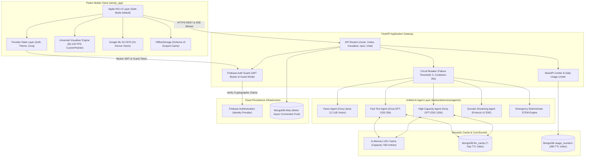

---

## 2. Component Breakdown

### 2.1 Flutter Mobile Client (`stemly_app/`)

The mobile client is built with Flutter 3.x and Dart 3.x, targeting Android and iOS with Apple Human Interface Guidelines (HIG) compliance:

```
stemly_app/lib/
├── main.dart                       # App entrypoint, Provider registration & route definitions
├── firebase_options.dart           # Generated Firebase multi-platform configuration
│
├── core/                           # Foundation configurations
│   ├── app_config.dart             # Dynamic base URL resolution (LAN, emulator, web)
│   ├── app_dialogs.dart            # Standard Apple HIG alert dialogs & action sheets
│   └── app_motion.dart             # 240-260ms Curves.easeOutCubic & Reduce Motion utilities
│
├── data/                           # Data models & local storage
│   ├── offline_storage.dart        # Multi-tenant Schema v3 storage scoped by user UID
│   └── scan_history.dart           # Scan history entity model
│
├── presentation/                   # Shared HIG components
│   ├── app_scaffold.dart           # Edge-to-edge scaffold with translucent HIG navigation
│   ├── app_segmented_control.dart  # Smooth animated sliding pill toggle
│   ├── buttons.dart                # Primary, Secondary, and Destructive buttons
│   └── form_fields.dart            # Apple-style text fields with clear buttons & icons
│
├── quiz/                           # Interactive Quiz Suite
│   ├── quiz_play_screen.dart       # Timed/untimed MCQ runner with instant feedback
│   └── quiz_result_screen.dart     # Diagnostic score breakdown, review & retake view
│
├── screens/                        # Full-Page Screen Implementations
│   ├── splash_screen.dart          # Apple HIG 1.2s entrance sequence (scan line + arc)
│   ├── scan_arc_painter.dart       # CustomPainter for projectile parabolic arc
│   ├── login_screen.dart           # Auth suite (Sign In, Create Account, Google, Guest)
│   ├── home_screen.dart            # Dashboard, camera viewfinder, quick action tiles
│   ├── scan_result_screen.dart     # Scan tabs: Visualiser, AI Notes, Socratic Chat, Quiz Setup
│   ├── history_screen.dart         # Multi-tenant past scans with search & filter chips
│   ├── history_detail_screen.dart  # Rehydrated scan detail with actions
│   ├── settings_screen.dart        # Dark mode default, theme provider, API key overrides
│   └── account_screen.dart         # User profile, cloud sync stats, sign-out & account deletion
│
├── services/                       # Client Service Layer
│   ├── firebase_auth_service.dart  # Multi-auth manager (Email, Google, Apple, Guest)
│   ├── api_service.dart            # HTTP client with token injection & error unwrapping
│   └── groq_service.dart           # Multimodal client manager
│
├── theme/                          # Apple HIG Design System Tokens
│   ├── app_colors.dart             # Pure black (#000000), #1C1C1E surfaces, #FF8A3D accents
│   ├── app_typography.dart         # SF Pro / system font hierarchy with 200% dynamic scaling
│   └── theme_provider.dart         # Light / Dark mode notifier (Default: Dark)
│
└── visualiser/                     # Universal Physics Visualiser Engine (60-120 FPS)
    ├── visualiser_factory.dart     # Factory: templateId → Simulation Widget
    ├── visualiser_models.dart      # Parameter definitions, ranges, units & AST models
    ├── visualiser_screen.dart      # Container with Hero 4:3 canvas, parameter sliders & chat
    ├── projectile_motion.dart      # 2D parabolic projectile simulation with drag
    ├── shm_component.dart          # Mass-spring & pendulum harmonic oscillators
    ├── optics_component.dart       # Ray tracing, thin lens equation & refraction
    ├── kinematics_component.dart   # Rectilinear motion with live x-t, v-t, a-t graphs
    ├── free_fall_component.dart    # Gravitational acceleration & impact telemetry
    ├── atom_component.dart         # Bohr model multi-shell orbital electrons (Z=1 to 20)
    ├── graph_component.dart        # Quadratic & polynomial curve plotter
    ├── equation_plotter.dart       # AST math expression plotter with discontinuity shields
    ├── declarative_physics.dart    # Inclined plane, Atwood pulleys & elastic collisions
    └── phet_simulation_widget.dart # Secure sandboxed bridge for PhET Colorado simulations
```

### 2.2 FastAPI Cloud Backend (`backend/`)

The backend is built with Python 3.12 and FastAPI, orchestrated with Astral `uv`:

```
backend/
├── main.py                         # FastAPI initialization, CORS, global error handlers
├── config.py                       # Pydantic BaseSettings, model IDs & timeout configurations
│
├── auth/                           # Authentication & Authorization Guard
│   ├── auth_middleware.py          # require_firebase_user with Dev & Guest bypass protocol
│   ├── firebase.py                 # Firebase Admin SDK cryptographic JWT verification
│   └── auth_router.py              # Profile inspection & GDPR data deletion
│
├── core/                           # Resilience, Safety & Observability
│   ├── circuit_breaker.py          # Upstream failure detection with cooldown states
│   ├── usage_limiter.py            # Daily per-user LLM invocation quota with MongoDB TTL
│   ├── rate_limiter.py             # SlowAPI token-bucket rate limiting
│   ├── guardrails.py               # Pre-flight prompt inspection & academic deflection
│   ├── safety.py                   # Post-generation content filtering
│   ├── parameter_sanitizer.py      # Mathematical clamp & AST validation for simulation params
│   └── observability.py            # Sentry APM tracing with PII scrubbing
│
├── database/                       # Async MongoDB Storage Tier
│   ├── db.py                       # Motor async client with resilient short timeouts
│   ├── user_model.py               # User profile schema & upsert operations
│   ├── history_model.py            # Multi-tenant scan history CRUD
│   ├── notes_model.py              # Structured notes persistence
│   └── visualiser_model.py         # Visualiser state persistence
│
├── models/                         # Strongly-Typed Pydantic v2 Models
│   ├── quiz.py                     # QuizQuestion, QuizResponse, QuizSubmission, QuizResult
│   ├── chat_protocol.py            # StreamEventEnvelope for Protocol v2 SSE streaming
│   ├── tools.py                    # Tool call definitions (UpdateSimulation, SuggestFollowups)
│   ├── scan.py                     # ScanUploadResponse, ScanHistoryItem
│   └── visualiser_models.py        # VisualTemplate, ParameterUpdateResponse
│
├── prompts/                        # System & Agent Prompts
│   ├── quiz_prompts.py             # V1 Prompt with exact count & difficulty controls
│   ├── notes_prompts.py            # V1 Comprehensive LaTeX study note prompts
│   ├── socratic_prompts.py         # Guided step-by-step Socratic pedagogy prompts
│   └── visualiser_prompts.py       # Template matching & natural language update prompts
│
├── routers/                        # REST & Streaming API Routers
│   ├── scan.py                     # POST /scan/upload, GET /scan/history, DELETE /scan/{id}
│   ├── notes.py                    # POST /notes/generate, GET /notes, POST /notes/ask
│   ├── visualiser.py               # POST /visualiser/generate, POST /visualiser/update
│   ├── quiz_router.py              # GET /quiz/generate (count, difficulty), POST /quiz/submit
│   └── chat.py                     # POST /chat/stream (Protocol v2 SSE streaming)
│
└── services/
    ├── agents/                     # Centralized Unified AI Engine
    │   ├── client.py               # Async HTTPX clients for Groq and Gemini
    │   ├── engine.py               # Structured JSON caller with auto-repair retry
    │   ├── text.py                 # High-performance notes, quiz & chat orchestrator
    │   ├── vision.py               # Llama 3.2 Vision OCR & problem classifier
    │   ├── cache.py                # In-memory LRU + MongoDB persistent semantic cache
    │   ├── fallback.py             # Deterministic keyword detector & emergency question bank
    │   ├── context_manager.py      # Multi-turn conversation windowing & token truncation
    │   └── tutor_stream.py         # Async generator for Protocol v2 SSE streaming
    ├── ocr.py                      # Multi-pass OCR preprocessor
    └── storage.py                  # Magic-byte file validation (PNG, JPEG) & storage
```

---

## 3. End-to-End Data Pipelines

### 3.1 Scan-to-Simulation Pipeline

The primary workflow transforms an unconstrained photo of a textbook problem into a real-time, parameter-driven physics canvas:

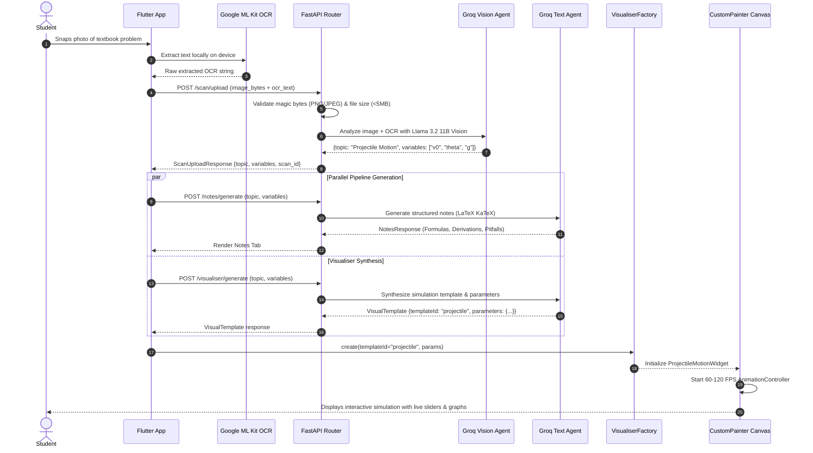

---

### 3.2 Adaptive Quiz Generation Pipeline (Up to 20 Questions)

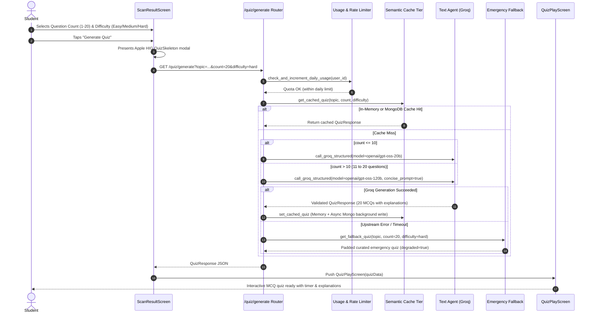

---

### 3.3 Socratic Streaming Chat Pipeline (Protocol v2)

The Socratic tutor implements **Protocol v2** with Server-Sent Events (SSE) streaming envelopes, grounding every conversation turn in the scanned problem context:

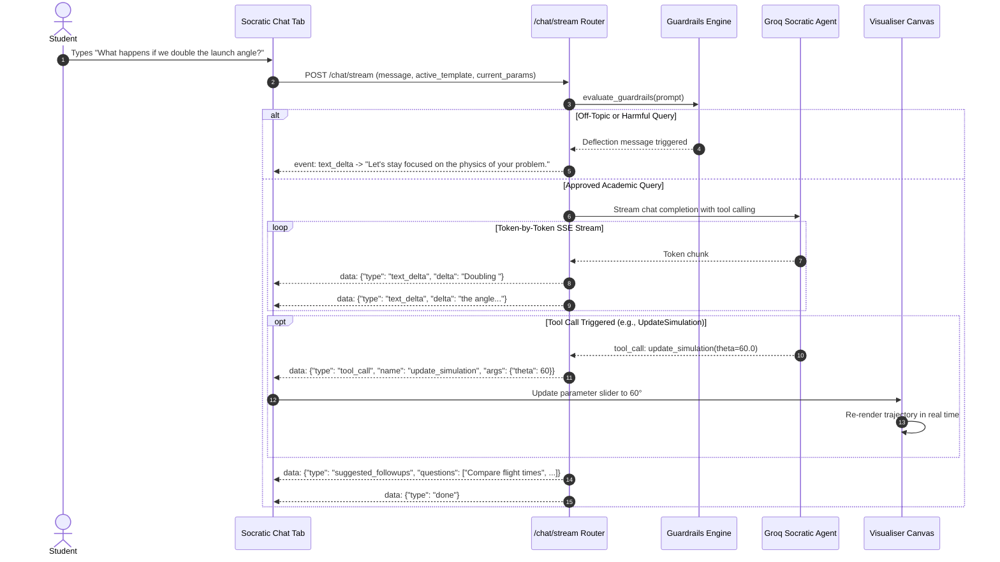

---

### 3.4 Apple HIG Splash Entrance & Handoff Pipeline

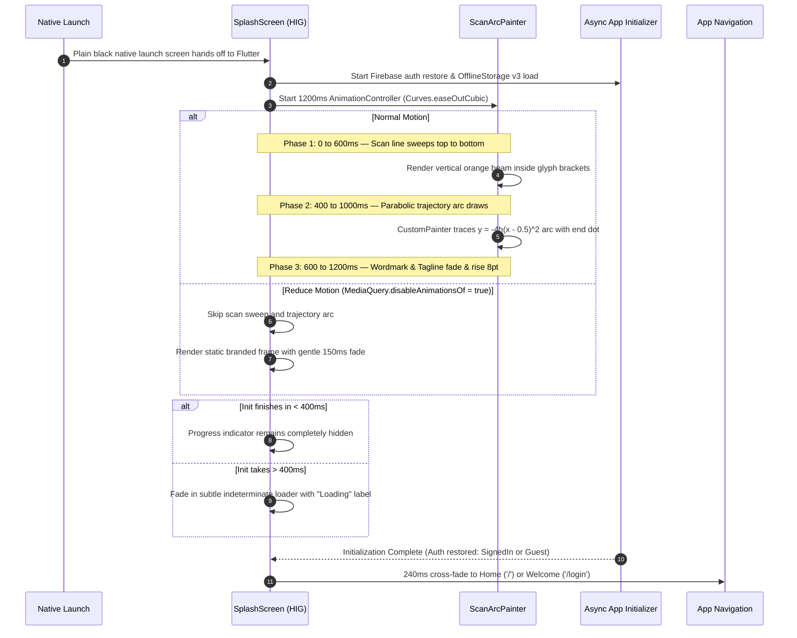

---

### 3.5 Multi-Tenant Authentication & Guest Mode Flow

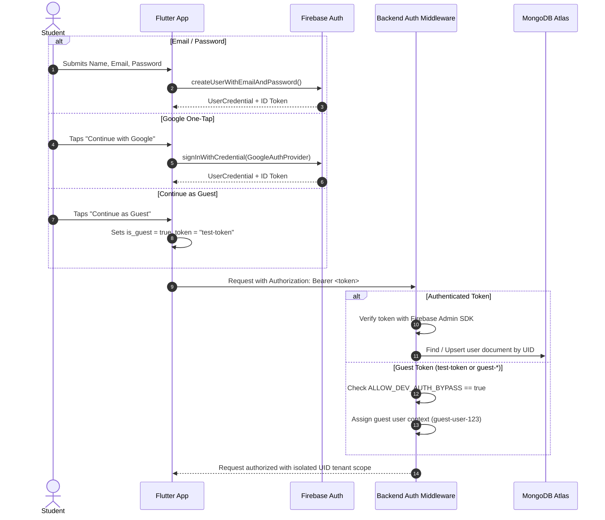

---

## 4. AI Agent & Inference Engine (`services/agents/`)

### 4.1 Multi-Tier Model Routing

STEMLY orchestrates multiple specialized models to optimize for latency, reasoning depth, and cost efficiency:

| Workload | Primary Model | Failover Provider | Target Latency | Max Tokens |
| :--- | :--- | :--- | :---: | :---: |
| **Problem OCR & Topic Classification** | `llama-3.2-11b-vision-preview` | Google Gemini 1.5 Flash | $\sim 1.2\text{ s}$ | 1,024 |
| **LaTeX Study Notes Generation** | `openai/gpt-oss-20b` | Google Gemini 2.0 Flash | $\sim 3.5\text{ s}$ | 2,500 |
| **Quizzes ($\le 10$ Questions)** | `openai/gpt-oss-20b` | Emergency Static Bank | $\sim 3.0\text{ s}$ | 3,500 |
| **Quizzes ($11\text{--}20$ Questions)** | `openai/gpt-oss-120b` | Emergency Static Bank | $\sim 9.5\text{ s}$ | 4,096 |
| **Socratic Guided Tutoring** | `openai/gpt-oss-120b` | Google Gemini 1.5 Pro | Token Stream | 1,500 |
| **Simulation Parameter Updates** | `openai/gpt-oss-20b` | Rule-Based Sanitizer | $\sim 800\text{ ms}$ | 800 |

### 4.2 Two-Tier Semantic LLM Caching

To prevent redundant API invocations and bound cloud operating costs, STEMLY uses a two-tier semantic caching engine:

1. **Tier 1: In-Memory LRU Cache**:
   - Capacity: 500 entries.
   - Zero-latency retrieval ($\le 1\text{ ms}$).
   - Thread-safe `OrderedDict` with timestamp invalidation.
2. **Tier 2: MongoDB Persistent Collection (`llm_cache`)**:
   - Document key: SHA-256 hash of `type:version:normalized_topic:params:difficulty`.
   - 7-day automatic TTL expiration via MongoDB index:
     ```javascript
     db.llm_cache.createIndex({ "created_at": 1 }, { expireAfterSeconds: 604800 })
     ```
   - **Non-blocking execution**: Cache reads enforce a strict $1.0\text{ s}$ timeout; cache writes are executed asynchronously in detached background tasks (`asyncio.create_task`).

### 4.3 Circuit Breaker & Emergency Fallbacks

The backend protects upstream LLM dependencies via `GroqCircuitBreaker`:
- **State Machine**: `CLOSED` $\rightarrow$ `OPEN` $\rightarrow$ `HALF_OPEN`.
- **Threshold**: 5 consecutive $5xx$ or $429$ HTTP responses trip the breaker into `OPEN`.
- **Cooldown**: 30.0 seconds cooldown period before entering `HALF_OPEN` to probe upstream recovery.
- **Graceful Degradation**: When tripped or during complete network outages, the system immediately routes to `get_fallback_quiz` and `_fallback_notes`, returning structured responses flagged with `degraded: true`.

### 4.4 Daily Per-User LLM Quota Limiting

To eliminate malicious or accidental cost explosions:
- Every authenticated user is bound to a daily quota (`DAILY_LLM_QUOTA = 50` requests/day).
- Enforced atomically via MongoDB `$inc` and `$setOnInsert`:
  ```python
  doc = await asyncio.wait_for(
      usage_counters_collection.find_one_and_update(
          {"_id": f"{user_id}:{today_str}"},
          {"$inc": {"count": cost}, "$setOnInsert": {"expires_at": expires_at}},
          upsert=True,
          return_document=ReturnDocument.AFTER,
      ),
      timeout=1.5,
  )
  ```
- Automatically resets at 00:00 UTC via date-keyed documents with a 48-hour TTL index.

---

## 5. Universal Visualiser Engine

### 5.1 Template Factory & Physics Models

The Flutter frontend features a custom, high-performance computational simulation engine capable of rendering 60 to 120 FPS on modern mobile displays:

| Template ID | Visualizer Widget | Key Parameters | Governing Physics Equations |
| :--- | :--- | :--- | :--- |
| `projectile` | `ProjectileMotionWidget` | $v_0 \in [0, 100]\text{ m/s}$<br>$\theta \in [0, 90]^\circ$<br>$g \in [1, 25]\text{ m/s}^2$ | $x(t) = v_0 \cos\theta \cdot t$<br>$y(t) = v_0 \sin\theta \cdot t - \frac{1}{2}gt^2$<br>$R = \frac{v_0^2 \sin(2\theta)}{g}$ |
| `simple_harmonic` | `SHMWidget` | $m \in [0.1, 10]\text{ kg}$<br>$k \in [1, 100]\text{ N/m}$<br>$A \in [0.1, 5]\text{ m}$ | $\omega = \sqrt{\frac{k}{m}}$<br>$x(t) = A \cos(\omega t + \phi)$<br>$E = \frac{1}{2}kA^2$ |
| `optics` | `OpticsWidget` | $f \in [-50, 50]\text{ cm}$<br>$d_o \in [5, 100]\text{ cm}$<br>$h_o \in [1, 20]\text{ cm}$ | $\frac{1}{f} = \frac{1}{d_o} + \frac{1}{d_i}$<br>$m = -\frac{d_i}{d_o} = \frac{h_i}{h_o}$<br>$n_1 \sin\theta_1 = n_2 \sin\theta_2$ |
| `kinematics` | `KinematicsWidget` | $u \in [0, 50]\text{ m/s}$<br>$a \in [-10, 10]\text{ m/s}^2$<br>$t \in [0, 20]\text{ s}$ | $v = u + at$<br>$s = ut + \frac{1}{2}at^2$<br>$v^2 = u^2 + 2as$ |
| `free_fall` | `FreeFallWidget` | $h \in [1, 200]\text{ m}$<br>$g \in [1, 25]\text{ m/s}^2$ | $v = \sqrt{2gh}$<br>$t = \sqrt{\frac{2h}{g}}$ |
| `inclined_plane` | `DeclarativePhysicsWidget` | $\theta \in [0, 75]^\circ$<br>$\mu \in [0, 1]$<br>$m \in [1, 50]\text{ kg}$ | $a = g(\sin\theta - \mu\cos\theta)$<br>$N = mg\cos\theta$<br>$f_k = \mu N$ |
| `pulley` | `DeclarativePhysicsWidget` | $m_1 \in [1, 20]\text{ kg}$<br>$m_2 \in [1, 20]\text{ kg}$ | $a = \frac{\|m_1 - m_2\|}{m_1 + m_2}g$<br>$T = \frac{2m_1 m_2}{m_1 + m_2}g$ |
| `collision` | `DeclarativePhysicsWidget` | $m_1, m_2$<br>$u_1, u_2$<br>$e \in [0, 1]$ | $m_1 u_1 + m_2 u_2 = m_1 v_1 + m_2 v_2$<br>$v_2 - v_1 = e(u_1 - u_2)$ |
| `bohr_atom` | `BohrAtomWidget` | $Z \in [1, 20]$ (Hydrogen to Calcium)<br>Orbit speed | $r_n = \frac{n^2 \hbar^2}{m_e k_e Z e^2}$<br>$E_n = -\frac{13.6\text{ eV} \cdot Z^2}{n^2}$ |
| `equation_plotter` | `EquationPlotterWidget` | Math expression ($f(x)$)<br>$x_{\min}, x_{\max}$ | Abstract Syntax Tree evaluation with asymptote discontinuity clamping |

### 5.2 Real-Time Kinematic Telemetry

The simulation canvas synchronizes with real-time time-series plots:
- **Position-Time ($x\text{-}t$)**: Displays displacement evolution.
- **Velocity-Time ($v\text{-}t$)**: Area under curve indicates total displacement; slope represents acceleration.
- **Acceleration-Time ($a\text{-}t$)**: Constant horizontal lines for uniform gravity ($a = -9.8\text{ m/s}^2$) or zero for inertial drift.

### 5.3 Parameter Sanitization & Natural Language Control

When a user prompts the Socratic assistant or modifies parameters via natural language:
1. `backend/core/parameter_sanitizer.py` parses candidate numerical values.
2. Validates against hard boundaries ($v_0 \ge 0$, $\theta \in [0, 90]$, $m > 0$).
3. Rejects illegal or NaN/infinite inputs before relaying updates back to Flutter.

---

## 6. Database & Storage Architecture

### 6.1 MongoDB Atlas Collections & Schema Definitions

```
stemly_db/
├── users
│   ├── _id: ObjectId
│   ├── uid: string (Firebase UID, unique index)
│   ├── email: string (indexed)
│   ├── name: string
│   ├── picture: string
│   └── last_login: datetime
│
├── scan_history
│   ├── _id: ObjectId
│   ├── user_id: string (Firebase UID, compound index with timestamp)
│   ├── topic: string
│   ├── variables: string[]
│   ├── image_path: string
│   ├── ocr_text: string
│   └── timestamp: datetime (TTL or descending sort index)
│
├── notes
│   ├── _id: ObjectId
│   ├── user_id: string (Firebase UID, indexed)
│   ├── topic: string
│   ├── content: object (Pydantic NotesResponse)
│   └── created_at: datetime
│
├── visualiser_states
│   ├── _id: ObjectId
│   ├── user_id: string (Firebase UID, indexed)
│   ├── template_id: string
│   ├── parameters: object (current simulation state)
│   └── saved_at: datetime
│
├── chat_sessions
│   ├── _id: ObjectId
│   ├── user_id: string (Firebase UID, indexed)
│   ├── session_id: string (unique index)
│   ├── history: array of {role, content, timestamp}
│   └── updated_at: datetime
│
├── llm_cache
│   ├── _id: ObjectId
│   ├── cache_key: string (SHA-256 hash, unique index)
│   ├── type: string ("notes" | "quiz" | "tutor")
│   ├── version: string ("v1")
│   ├── payload: object
│   └── created_at: datetime (7-day TTL index)
│
└── usage_counters
    ├── _id: string ("{user_id}:{YYYY-MM-DD}")
    ├── user_id: string
    ├── date: string
    ├── count: integer (incremented atomically)
    └── expires_at: datetime (48-hour TTL index)
```

### 6.2 Client-Side Offline Storage Schema v3

The mobile application persists user state offline using SharedPreferences with scoped user isolation keys:
- **Scan History**: `stemly_history_v3_${uid}` — JSON array of past scans (max 50 items).
- **Study Notes**: `stemly_notes_v3_${uid}` — Map of topic $\rightarrow$ full notes payload.
- **Migration Handler**: Automatically detects schema version on startup (`v1` / `v2` $\rightarrow$ `v3`), migrating legacy records safely and stamping `stemly_schema_version = 3`.

### 6.3 Connection Pool Resilience

To prevent database hangs from blocking mobile clients, `backend/database/db.py` enforces fail-fast connection pooling:
- `serverSelectionTimeoutMS`: **2500 ms** (aborts if Atlas replica set is unreachable).
- `connectTimeoutMS`: **3000 ms** (aborts hanging socket connections).
- `socketTimeoutMS`: **5000 ms** (aborts slow operational reads).
- `maxPoolSize`: 50 | `minPoolSize`: 5.

---

## 7. Security, Privacy & IDOR Prevention

1. **Insecure Direct Object Reference (IDOR) Protection**:
   - Every read, update, or deletion query on `/scan/{scan_id}` or `/notes/{notes_id}` asserts:
     ```python
     query = {"_id": ObjectId(scan_id), "user_id": request.state.user["uid"]}
     ```
   - An authenticated user attempting to access another user's scan receives an immediate `404 Not Found` or `403 Forbidden`.
2. **Cryptographic Token Verification**:
   - Production requests verify Firebase JWT signatures, expiration (`exp`), audience (`aud`), and issuer (`iss`) via `firebase_admin.auth.verify_id_token`.
3. **GDPR Account Wipe (`DELETE /auth/me/data`)**:
   - Permanently deletes all scans, notes, chat transcripts, and simulation states belonging to the requesting UID across all collections in a single transactional operation.
4. **Image Magic-Byte Validation**:
   - Files uploaded to `/scan/upload` are validated against strict binary magic bytes (`\x89PNG` and `\xFF\xD8\xFF`). Executable file extensions and MIME-spoofing are rejected immediately.
5. **PII Scrubbing in Telemetry**:
   - Sentry APM integrations scrub email addresses, passwords, prompt text, and student names before emitting stack traces.

---

## 8. Visual Architecture Showcase

| Architectural Subsystem | Visual Implementation Evidence |
| :--- | :--- |
| **Home Dashboard & Viewfinder** | 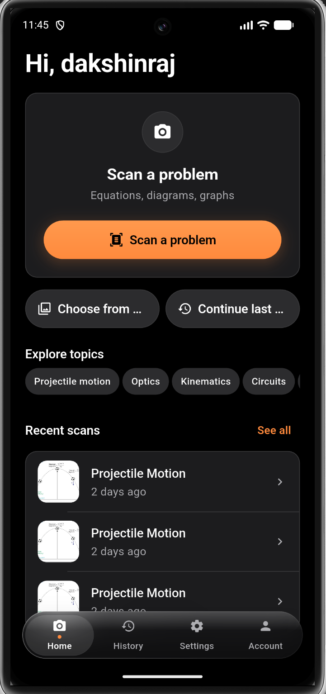 |
| **Universal Visualiser Engine** | 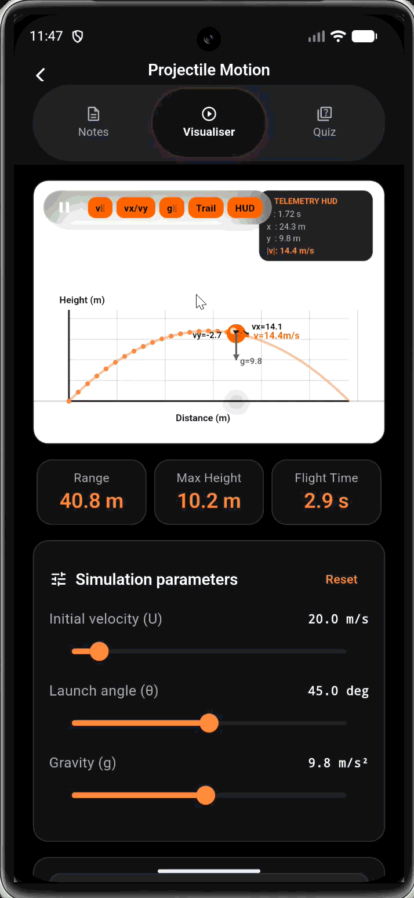 |
| **AI Structured LaTeX Notes** |  |
| **Adaptive Quiz Player (1–20 Qs)**| 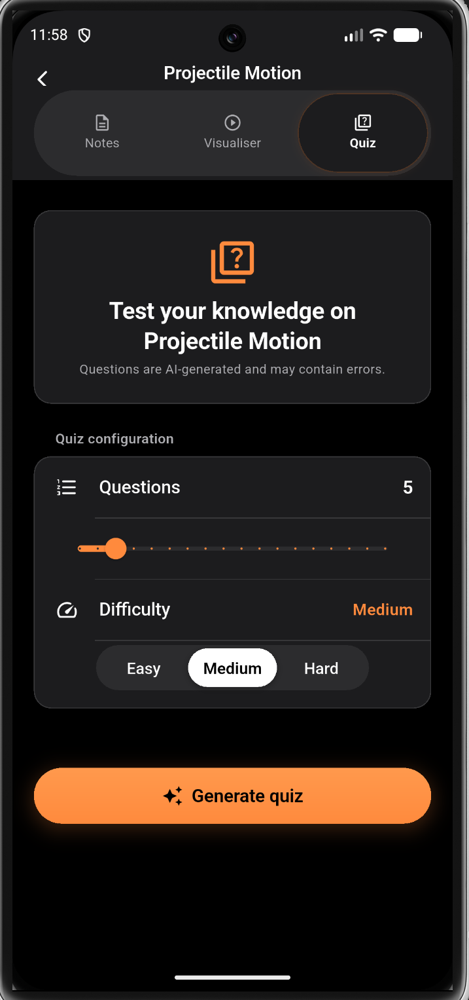 |
| **Multi-Tenant History Store** | 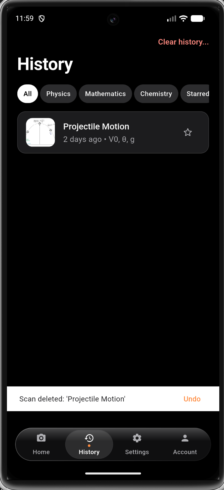 |
| **User Privacy & Account Wipe** | 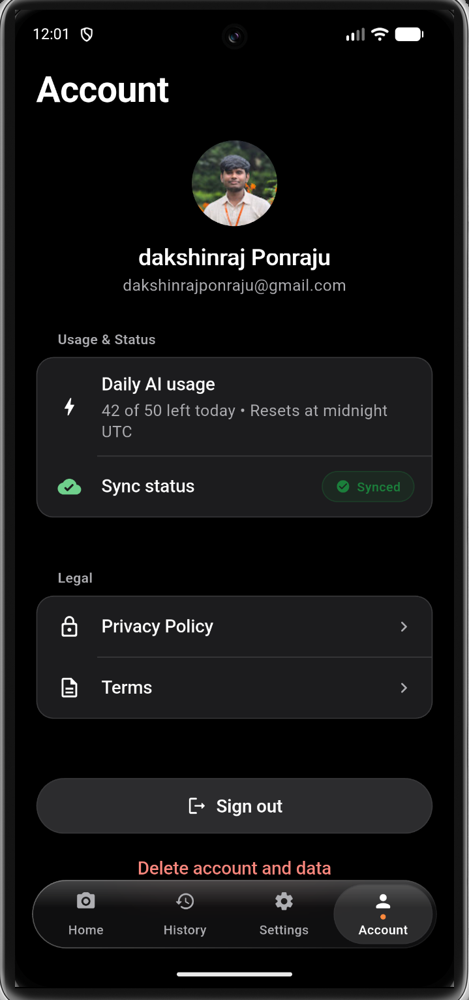 |
| **Apple HIG Sign In Suite** | 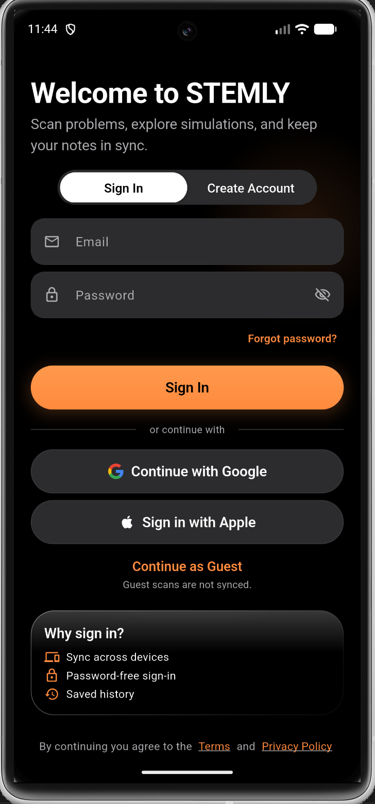 |
| **Apple HIG Registration** | 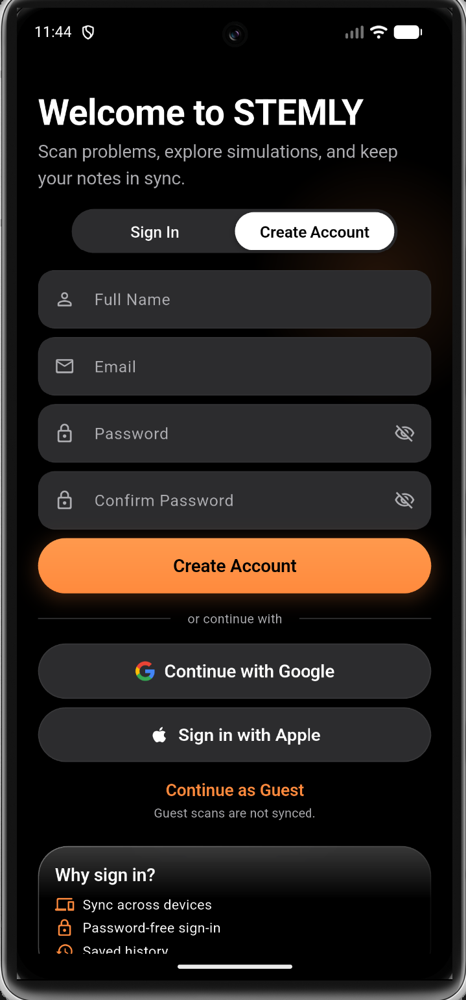 |
| **Settings & Dark Mode System** | 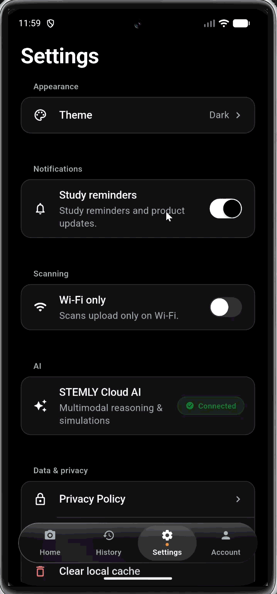 |

---

<div align="center">
  <sub>STEMLY Architecture Specification v2.0 • Maintained by Team Mugiwara Coders</sub>
</div>
