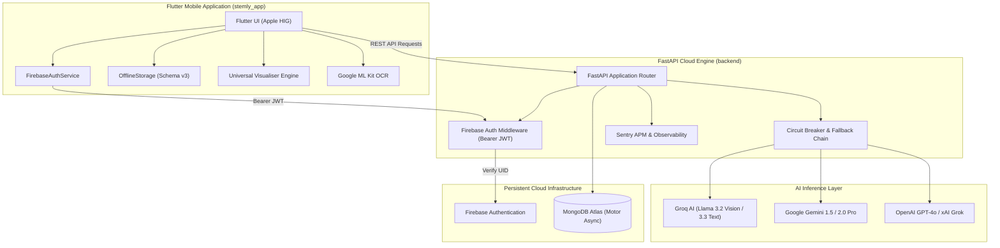

<p align="center">
  <h1 align="center">STEMLY</h1>
  <p align="center"><strong>Scan. Visualise. Learn.</strong></p>
  <p align="center">
    An AI-powered multi-modal STEM learning platform that transforms textbook problems and diagrams into real-time interactive simulations, structured study notes, socratic AI tutoring, and adaptive quizzes.
  </p>
</p>

<p align="center">
  <a href="https://github.com/SH-Nihil-Mukkesh-25/Stemly/actions/workflows/flutter-ci.yml"></a>
  <a href="https://github.com/SH-Nihil-Mukkesh-25/Stemly/actions/workflows/backend-ci.yml"></a>
  <a href="LICENSE"></a>
  
  
</p>

<p align="center">
  
  
  
  
  
  
  
  
  
</p>

---

## Table of Contents

- [The Educational Challenge](#the-educational-challenge)
- [The STEMLY Solution](#the-stemly-solution)
- [Interactive UI Showcase](#interactive-ui-showcase)
- [Core Features](#core-features)
  - [1. AI Universal Visualiser Engine](#1-ai-universal-visualiser-engine)
  - [2. AI Structured Study Notes](#2-ai-structured-study-notes)
  - [3. Socratic AI Tutor](#3-socratic-ai-tutor)
  - [4. Smart Adaptive Quizzes](#4-smart-adaptive-quizzes)
  - [5. Apple HIG Design & Dark Mode Default](#5-apple-hig-design--dark-mode-default)
  - [6. Multi-Tenant Isolation & Cloud Sync](#6-multi-tenant-isolation--cloud-sync)
  - [7. Complete Authentication Suite](#7-complete-authentication-suite)
- [System Architecture](#system-architecture)
- [API Overview](#api-overview)
- [Getting Started](#getting-started)
  - [Prerequisites](#prerequisites)
  - [Backend Setup](#backend-setup)
  - [Mobile App Setup (Flutter)](#mobile-app-setup-flutter)
  - [Environment Variables](#environment-variables)
- [Testing & Quality Assurance](#testing--quality-assurance)
- [Project Structure](#project-structure)
- [Documentation Index](#documentation-index)
- [Team & Acknowledgments](#team--acknowledgments)
- [License](#license)

---

## The Educational Challenge

STEM students frequently struggle with visualizing abstract physical laws and mathematical concepts from static textbooks and 2D chalkboard sketches:
- **Theory vs. Intuition Gap**: Reading formulas such as $y(t) = v_0 t - \frac{1}{2}gt^2$ does not build intuitive mental models of trajectories or harmonic resonance.
- **Passive Learning**: Traditional video explanations are non-interactive—students cannot adjust variables like gravity, friction, mass, or refractive indices to observe outcomes dynamically.
- **Fragmented Workflows**: Students juggle multiple disjoint tools for scanning, notes, calculators, simulations, and tutoring without unified session continuity.

---

## The STEMLY Solution

With **STEMLY**, a student simply snaps a photo of any handwritten equation, textbook problem, or physics diagram. The platform orchestrates on-device OCR, multi-modal vision LLMs, and real-time canvas rendering into four unified pillars:

1. **AI Visualiser**: Instantly synthesizes 60–120 FPS parameter-driven interactive physics simulations with live time-series graphs ($x\text{-}t$, $v\text{-}t$, $a\text{-}t$) and natural language adjustments.
2. **AI Study Notes**: Generates complete conceptual breakdowns, mathematical derivations with LaTeX rendering, worked examples, and curated references.
3. **Socratic AI Tutor**: A guided conversational assistant that fosters critical thinking step-by-step rather than spoiling direct answers.
4. **Smart Diagnostic Quizzes**: Automatically constructs conceptual multiple-choice checks with immediate diagnostic reasoning.

---

## Interactive UI Showcase

<div align="center">

| Welcome & Onboarding | Live Scanning & OCR | Home Dashboard |
|:---:|:---:|:---:|
|  |  |  |

| AI Universal Visualiser | AI Study Notes | Settings & Preferences |
|:---:|:---:|:---:|
|  |  |  |

</div>

---

## Core Features

### 1. AI Universal Visualiser Engine

Not a canned video—STEMLY generates live, computational visual models with interactive parameter controls:

- **Interactive Sliders**: Tweak velocity, launch angle, mass, gravitational acceleration, air resistance, spring constant, or index of refraction in real time.
- **Natural Language Control**: Prompt the simulation with questions like *"What if gravity was zero?"* or *"Double the friction"* and watch parameters reconfigure dynamically.
- **Real-Time Kinematic Graphs**: Live synchronized plots for position-time ($x$-$t$), velocity-time ($v$-$t$), and acceleration-time ($a$-$t$).
- **10+ Native Simulation Templates**:
  - **Projectile Motion**: Multi-trajectory parabolic paths with max height and range indicators.
  - **Simple Harmonic Motion (SHM)**: Mass-spring and pendulum oscillators with phase space plots.
  - **Ray Optics & Refraction**: Convex/concave lenses, focal points, and Snell's Law refractions.
  - **Kinematics & Free Fall**: Uniform and accelerated rectilinear motion.
  - **Inclined Plane & Friction**: Normal forces, gravitational components, and static/kinetic friction.
  - **Pulley Systems & Tension**: Atwood machines with coupled accelerations.
  - **Elastic & Inelastic Collisions**: Momentum and kinetic energy conservation analysis.
  - **Bohr Atom Multi-Shell Model**: Electron configurations, quantum numbers, and shell orbits.
  - **Equation Plotter & AST Visualizer**: Safe mathematical function plotting with asymptote and discontinuity protections ($1/x$, $\sqrt{x}$).
  - **PhET Interactive Simulation Sandbox**: Secure iframe bridge to validated PhET Colorado simulations.

### 2. AI Structured Study Notes

- **Concept Breakdowns**: Core principles explained in accessible, intuitive prose.
- **LaTeX Math Rendering**: Beautiful typography for equations using KaTeX and MathJax.
- **Step-by-Step Derivations**: Complete solutions showing intermediate algebraic steps.
- **Offline Storage**: Notes cached locally for instant revision without internet access.

### 3. Socratic AI Tutor

- **Socratic Pedagogy**: Guides learners through guiding questions, hints, and checks rather than outputting immediate answers.
- **Scanned Context Grounding**: The AI tutor reads the exact problem image, extracted text, and active simulation parameters.
- **Multi-Provider Resilience**: Seamless fallback between Google Gemini 1.5/2.0, OpenAI GPT-4o, xAI Grok, Anthropic Claude, and Groq Llama 3.3 70B via an automatic Circuit Breaker.
- **Streaming Chat Protocol v2**: Low-latency token-by-token streaming with markdown and LaTeX formatting.

### 4. Smart Adaptive Quizzes

- Auto-generated diagnostic MCQs tailored directly to the scanned topic.
- Immediate feedback with rich explanations for both correct and incorrect options.
- Performance tracking to identify learning gaps and recommend targeted reviews.

### 5. Apple HIG Design & Dark Mode Default

STEMLY follows a strict implementation of Apple's Human Interface Guidelines (HIG):

- **Default Dark Mode**: Deep pure black (`#000000`) for OLED power efficiency, paired with `#1C1C1E` and `#2C2C2E` neutral surfaces.
- **80–85% Neutral Palette**: High-contrast typography with zero blue palette violations.
- **Vibrant Orange Accents**: Whitelisted `#FF6B00` (Light) and `#FF8A3D` (Dark) accents for primary interactive controls (15–20% visual weight).
- **Apple Motion**: 240–260ms smooth transitions utilizing `Curves.easeOutCubic` and sliding pill indicators (`AppSegmentedControl`).
- **Full Accessibility**: Compliant with 200% dynamic type scale and WCAG AAA contrast ratios.

### 6. Multi-Tenant Isolation & Cloud Sync

Enterprise-grade user data isolation guarantees that **User A never sees User B's scans or notes**:

- **Database-Level Isolation**: All MongoDB Atlas collections (`scans`, `notes`, `chat_sessions`, `visualiser`) enforce authenticated UID indexing (`user_id`).
- **IDOR Protection**: Backend routers verify token ownership before executing reads, updates, or deletes.
- **Local Storage Schema v3**: Scoped cache keys (`stemly_history_v3_${uid}` and `stemly_notes_v3_${uid}`).
- **Zero-Residue Sign-Out**: Memory and local cache are flushed upon sign-out.
- **Cloud Rehydration**: Scans and notes sync automatically from MongoDB Atlas on login.
- **Guest Migration**: Guests explore locally; upon creating an account, guest history safely migrates to the cloud.

### 7. Complete Authentication Suite

- **Email & Password Authentication**:
  - Full Name collection (powers the *"Hi, {Name}"* home greeting).
  - Live email format validation.
  - Password field with show/hide toggle.
  - Confirm password verification.
  - Forgot password password-reset link distribution via Firebase Auth.
  - User-friendly error messaging for common auth exceptions.
- **Continue with Google**: One-tap sign-in with authentic multi-colored Google "G" logo.
- **Sign in with Apple**: Native iOS and cross-platform credential integration.
- **Continue as Guest**: Zero-friction exploration without upfront registration.

---

## System Architecture



### Technology Matrix

| Layer | Technologies & Tools |
| :--- | :--- |
| **Mobile Client** | Flutter 3.x, Dart 3.x, Provider, CustomPainter (60–120 FPS), Google ML Kit OCR, KaTeX |
| **Backend API** | FastAPI, Python 3.12, Uvicorn, Astral `uv`, Pydantic v2, Motor (Async MongoDB) |
| **AI & Vision** | Groq Llama 3.2 11B/90B Vision, Groq Llama 3.3 70B, Google Gemini 1.5/2.0, OpenAI GPT-4o |
| **Database** | MongoDB Atlas with composite compound indexes (`user_id`, `created_at`) |
| **Identity & Security** | Firebase Auth (JWT Bearer tokens), strict IDOR checks, GDPR `DELETE /auth/me/data` |
| **Monitoring & Quality** | Sentry APM with PII scrubbing, Pytest, Flutter Widget Test Suite |

---

## API Overview

The backend exposes clean REST endpoints documented with OpenAPI/Swagger at `/docs`:

| Endpoint | Method | Auth | Description |
| :--- | :---: | :---: | :--- |
| `/scan/upload` | `POST` | Optional | Upload and process diagram/problem image via Vision LLM |
| `/scan/history` | `GET` | Required | Retrieve paginated scan history scoped strictly to authenticated user |
| `/scan/{scan_id}` | `GET` | Required | Retrieve single scan details with IDOR validation |
| `/scan/{scan_id}` | `DELETE` | Required | Delete scan record and associated artifacts |
| `/notes/generate` | `POST` | Optional | Generate structured LaTeX study notes from scanned concept |
| `/notes` | `GET` | Required | Retrieve user's paginated notes collection |
| `/visualiser/generate`| `POST` | Optional | Synthesize simulation parameters and template matching |
| `/visualiser/modify` | `POST` | Optional | Process natural language modifications to simulation state |
| `/chat/stream` | `POST` | Optional | Streaming Socratic tutor chat session (Protocol v2) |
| `/quiz/generate` | `POST` | Optional | Generate diagnostic multiple-choice quiz questions |
| `/auth/me` | `GET` | Required | Retrieve current user profile and sync telemetry |
| `/auth/me/data` | `DELETE` | Required | GDPR compliant account wipe (scans, notes, chat sessions) |
| `/health` | `GET` | None | Service liveness, database connectivity, and circuit breaker status |

---

## Getting Started

### Prerequisites

Ensure the following tools are installed on your machine:
- **Flutter SDK**: 3.24+ ([Install Flutter](https://docs.flutter.dev/get-started/install))
- **Dart SDK**: 3.5+
- **Python**: 3.10+ (Python 3.12 recommended)
- **Astral uv**: Fast Python package manager ([Install uv](https://docs.astral.sh/uv/getting-started/installation/))
- **Git**

### Backend Setup

1. **Clone the repository**:
   ```bash
   git clone https://github.com/SH-Nihil-Mukkesh-25/Stemly.git
   cd Stemly/backend
   ```

2. **Install dependencies with Astral `uv`**:
   ```bash
   uv sync --extra dev
   ```

3. **Configure environment variables**:
   ```bash
   cp .env.example .env
   # Edit .env with your credentials (see table below)
   ```

4. **Launch the FastAPI development server**:
   ```bash
   uv run uvicorn main:app --host 0.0.0.0 --port 8080 --reload
   ```
   The backend will be live at `http://localhost:8080` (API documentation at `http://localhost:8080/docs`).

### Mobile App Setup (Flutter)

1. **Navigate to the Flutter directory**:
   ```bash
   cd ../stemly_app
   ```

2. **Install Flutter packages**:
   ```bash
   flutter pub get
   ```

3. **Run on an active device or emulator**:
   ```bash
   flutter run
   ```
   *(For Android Emulator, backend defaults to `http://10.0.2.2:8080`; for physical devices, provide `--dart-define=API_BASE_URL=http://YOUR_LAN_IP:8080`)*.

### Environment Variables

Configure these keys in `backend/.env`:

| Key | Required | Purpose |
| :--- | :---: | :--- |
| `GROQ_API_KEY` | **Yes** | Vision LLM (Llama 3.2) & high-speed reasoning (Llama 3.3) |
| `GEMINI_API_KEY` | Optional | Multimodal fallback and Socratic tutoring provider |
| `OPENAI_API_KEY` | Optional | Secondary multi-provider chat option (GPT-4o) |
| `MONGO_URI` | **Yes** | MongoDB Atlas connection string for persistent storage |
| `FIREBASE_PROJECT_ID`| **Yes** | Firebase project ID for token verification |
| `FIREBASE_CREDENTIALS`| Optional | Path to Firebase Admin service account JSON |
| `SENTRY_DSN` | Optional | Error tracking and APM telemetry |
| `ENVIRONMENT` | Optional | Set to `development` or `production` |

---

## Testing & Quality Assurance

Both the mobile application and backend service enforce automated test suites:

### 1. Flutter Test Suite (64 Tests)
Validates Apple HIG token compliance, zero-blue palette rules, 200% dynamic text scale, offline storage schema migrations, mathematical AST expression plotting, and simulation factory resolution:
```bash
cd stemly_app
flutter test
```
*Result: 64 / 64 passed (100%).*

### 2. Backend Test Suite (152 Tests)
Validates safety guardrails, prompt injection sanitization, circuit breaker triggers, LangSmith evaluations, multi-tenant UID isolation, and IDOR protection:
```bash
cd backend
uv run pytest
```
*Result: 152 / 152 passed (100%).*

---

## Project Structure

```
Stemly/
├── .github/
│   └── workflows/                # GitHub Actions CI for Flutter & Backend
├── docs/
│   ├── screenshots/              # High-resolution application screenshots
│   ├── API.md                    # Detailed REST endpoint reference
│   ├── ARCHITECTURE.md           # System design & data flow specifications
│   ├── CHAT_PROTOCOL.md          # Socratic streaming protocol reference
│   ├── DEVELOPMENT.md            # Contributor guidelines & setup
│   ├── FAQ.md                    # Frequently asked questions
│   └── ROADMAP.md                # Development milestones & roadmap
│
├── backend/                      # FastAPI Python Engine
│   ├── auth/                     # Firebase Auth middleware & user routing
│   ├── core/                     # Circuit breaker, rate limiting, guardrails
│   ├── database/                 # MongoDB Atlas async models & indexes
│   ├── models/                   # Pydantic schemas (scan, notes, visualiser, chat)
│   ├── prompts/                  # AI system prompts (vision, socratic, notes)
│   ├── routers/                  # API routes (/scan, /notes, /visualiser, /chat)
│   ├── services/                 # Business logic, OCR, and AI provider clients
│   ├── tests/                    # 152 Pytest unit & integration tests
│   ├── main.py                   # FastAPI server entrypoint
│   └── pyproject.toml            # uv project specification
│
└── stemly_app/                   # Flutter Mobile Client
    ├── assets/
    │   └── icons/                # High-res vectors & Google branding assets
    ├── lib/
    │   ├── core/                 # Flavor configurations & utilities
    │   ├── data/                 # API client & offline storage (v3)
    │   ├── models/               # Client-side data models
    │   ├── presentation/         # HIG components, buttons, segmented controls
    │   ├── quiz/                 # Interactive quiz player & score views
    │   ├── screens/              # Top-level application views (Scan, Notes, Auth)
    │   ├── services/             # Firebase Auth & API service providers
    │   ├── storage/              # Multi-tenant history store
    │   ├── theme/                # HIG design tokens, dark palette, typography
    │   ├── visualiser/           # 10+ Canvas physics simulation engines
    │   └── main.dart             # Application initialization
    └── test/                     # 64 Flutter widget & regression tests
```

---

## Documentation Index

- **[System Architecture](ARCHITECTURE.md)**: Deep dive into the scan-to-simulation pipeline and data models.
- **[REST API Reference](docs/API.md)**: Full request/response schemas and example cURL commands.
- **[Setup & Deployment Guide](docs/SETUP_GUIDE.md)**: Platform guides, Android APK builds, and Docker deployments.
- **[Socratic Chat Protocol](docs/CHAT_PROTOCOL.md)**: Protocol v2 specs for streaming tokens and tool calling.
- **[Development Guide](docs/DEVELOPMENT.md)**: Coding standards, adding new physics simulations, and Git workflows.
- **[Product Roadmap](docs/ROADMAP.md)**: Future milestones (circuits, chemistry, multi-language, AR).

---

## Team & Acknowledgments

STEMLY was engineered by **Team Mugiwara Coders** from Amrita Vishwa Vidyapeetham, Coimbatore:

| Team Member | Role | GitHub |
| :--- | :--- | :--- |
| **P Dakshin Raj** | AI Architecture & Full-Stack Development | [@Dakshin10](https://github.com/Dakshin10) |
| **SH Nihil Mukkesh** | Mobile Lead & Flutter Engineering | [@SH-Nihil-Mukkesh-25](https://github.com/SH-Nihil-Mukkesh-25) |
| **SHRE RAAM P J** | Backend Services & Cloud Infrastructure | [@SHRE-RAAM-P-J](https://github.com/SHRE-RAAM-P-J) |
| **Vibin Ragav S** | UI/UX & Interactive Simulations | [@VibinR-code](https://github.com/VibinR-code) |

---

## License

This project is licensed under the **MIT License** — see the [LICENSE](LICENSE) file for details.

<div align="center">
  <sub>Built with ❤️ by Team Mugiwara Coders. Transforming STEM education, one scan at a time.</sub>
</div>
