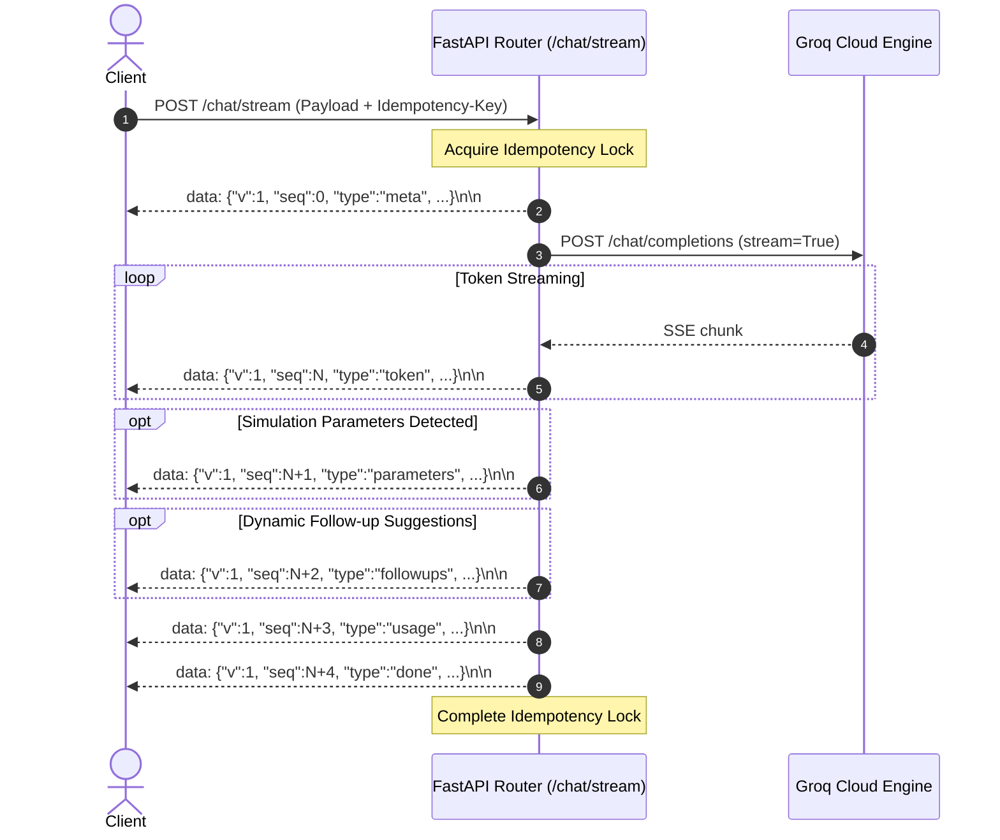

# Stemly AI Tutor Streaming Protocol v2 (SSE Specification)

## 1. Overview
The Stemly Streaming Protocol v2 delivers a ChatGPT/Claude-grade, real-time, bidirectional streaming experience over Server-Sent Events (SSE). It standardizes streaming frames under a strictly versioned envelope, enforces monotonic sequence integrity, detects early client disconnections to eliminate wasted upstream token generation, guarantees idempotent retries, and protects clients from raw stack trace leakage.

---

## 2. HTTP Transport & Headers

### Request Headers
| Header | Type | Description |
| :--- | :--- | :--- |
| `Authorization` | String | `Bearer <Firebase-JWT>` (Required) |
| `Content-Type` | String | `application/json` (Required) |
| `Idempotency-Key` | String | Optional UUID or transaction key to prevent duplicate stream processing on network retries |
| `X-Idempotency-Key`| String | Alias for `Idempotency-Key` |
| `X-Session-ID` | String | Optional persistent conversation session identifier |

### Response Headers
All streaming responses emit standard SSE headers with compression bypass:
```http
HTTP/1.1 200 OK
Content-Type: text/event-stream; charset=utf-8
Cache-Control: no-cache
Connection: keep-alive
X-Accel-Buffering: no
Content-Encoding: identity
```

> [!IMPORTANT]
> `Content-Encoding: identity` instructs Starlette `GZipMiddleware` and reverse proxies (Nginx/Cloudflare) to bypass gzip buffering, ensuring instant frame transmission with no artificial TTFT latency degradation.

---

## 3. Envelope Specification

Every SSE frame emitted by `POST /chat/stream` contains a JSON-serialized event envelope:
```json
{
  "v": 1,
  "id": "7a35c5c1-d41f-4c8d-b08c-9c94627d3c50",
  "seq": 0,
  "type": "meta",
  "data": { ... }
}
```

### Fields
- **`v`** (integer, default `1`): The protocol version.
- **`id`** (string): Unique identifier for the generation turn or message frame.
- **`seq`** (integer, `>= 0`): Monotonically increasing sequence number starting at `0`. Ensures clients can detect dropped, duplicated, or out-of-order packets.
- **`type`** (string): The event classification. Must be one of:
  - `meta`
  - `token`
  - `parameters`
  - `followups`
  - `usage`
  - `error`
  - `done`
- **`data`** (object): Typed payload corresponding to `type`.
- **Root convenience keys** (`content`, `updates`, `suggestions`): Provided on respective event types for backward compatibility with older v1 clients.

---

## 4. Event Frames & Lifecycle

The stream lifecycle follows a strict state transition:
`meta` -> `token`* -> (`parameters`?) -> (`followups`?) -> `usage` -> `done`



### 1. `meta` Event
Sent immediately as `seq: 0` before any upstream generation begins. Provides request correlation identifiers.
```sse
data: {"v": 1, "id": "3b29c92a-...", "seq": 0, "type": "meta", "data": {"request_id": "3b29c92a-...", "session_id": "sess-4091", "model": "openai/gpt-oss-120b", "created_at": 1700000000}}

```

### 2. `token` Event
Carries partial token chunks in real-time.
```sse
data: {"v": 1, "id": "3b29c92a-...", "seq": 1, "type": "token", "data": {"delta": "In "}, "content": "In "}

data: {"v": 1, "id": "3b29c92a-...", "seq": 2, "type": "token", "data": {"delta": "projectile "}, "content": "projectile "}

data: {"v": 1, "id": "3b29c92a-...", "seq": 3, "type": "token", "data": {"delta": "motion, "}, "content": "motion, "}

```

### 3. `parameters` Event
Emitted when the AI tutor alters the canvas simulation state. Parameters are clamped and sanitized server-side before delivery.
```sse
data: {"v": 1, "id": "3b29c92a-...", "seq": 4, "type": "parameters", "data": {"updates": {"initial_velocity": 35.0, "launch_angle": 60.0}}, "updates": {"initial_velocity": 35.0, "launch_angle": 60.0}}

```

### 4. `followups` Event
Delivers up to 3 context-aware, one-tap question suggestions.
```sse
data: {"v": 1, "id": "3b29c92a-...", "seq": 5, "type": "followups", "data": {"suggestions": ["What happens to the range if we double the angle?", "How does air resistance change the trajectory?", "Derive the maximum height formula"]}, "suggestions": ["What happens to the range if we double the angle?", "How does air resistance change the trajectory?", "Derive the maximum height formula"]}

```

### 5. `usage` Event
Emitted at the end of the generation with token consumption, latency, and TTFT metrics.
```sse
data: {"v": 1, "id": "3b29c92a-...", "seq": 6, "type": "usage", "data": {"prompt_tokens": 142, "completion_tokens": 310, "total_tokens": 452, "latency_ms": 1824.50, "ttft_ms": 612.30}}

```

### 6. `done` Event
Signals completion of the stream.
```sse
data: {"v": 1, "id": "3b29c92a-...", "seq": 7, "type": "done", "data": {"finish_reason": "stop"}}

```

### 7. `error` Event
Emitted when an unrecoverable mid-stream failure occurs. Always followed by a `done` event with `finish_reason: "error"`. Raw stack traces are never leaked.
```sse
data: {"v": 1, "id": "3b29c92a-...", "seq": 2, "type": "error", "data": {"code": "upstream_503", "message": "AI tutoring service temporarily degraded. Please try again.", "retryable": true}}

data: {"v": 1, "id": "3b29c92a-...", "seq": 3, "type": "done", "data": {"finish_reason": "error"}}

```

---

## 5. Idle Heartbeat (Keep-Alive)
To prevent network gateways, firewalls, and proxies from closing idle TCP sockets during model thinking or slow upstream responses:
- A comment frame `: ping\n\n` is permitted every ~15 seconds of idle streaming.
- SSE comment lines begin with `:` and are ignored by standard `EventSource` parsers while maintaining connection liveness.

---

## 6. Disconnect Handling & Token Conservation
The server continuously interrogates `request.is_disconnected()`.
If the user closes the app, navigates away, or loses connectivity:
1. The stream generator detects disconnection instantly.
2. The HTTP context to Groq Cloud is aborted (`httpx` closes the socket).
3. Token generation stops upstream immediately, saving Groq RPM and token quotas.

---

## 7. Idempotency Protection
Clients can submit `Idempotency-Key: <UUID>`.
- **First Request**: Key is marked `in_flight`.
- **Concurrent Duplicate**: Returns `HTTP 409 Conflict` (`A stream request with this Idempotency-Key is currently in flight.`).
- **Completed Re-submission**: Returns `HTTP 409 Conflict` (`A stream request with this Idempotency-Key has already completed.`).
- Keys expire automatically after a 5-minute TTL.
