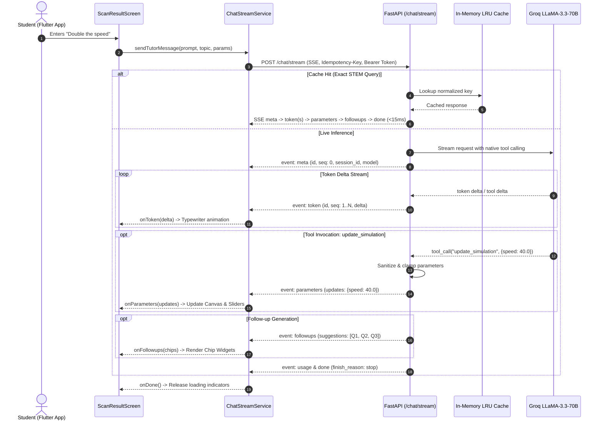

# Flutter Client Integration & Migration Guide (Streaming Protocol v2)

This document provides complete instructions, architecture specifications, and copy-pasteable Dart code for integrating the **Stemly Flutter Client (`stemly_app`)** with the hardened **Streaming Protocol v2** (`POST /chat/stream`).

---

## 1. Executive Summary & Why Migrate

### The Problem with Legacy Interaction
Previously, the Flutter application executed a blocking HTTP `POST` to `/visualiser/update` or `/chat/ask`. This created multiple production vulnerabilities:
- **High Perceived Latency**: The user stared at a spinner for **1.2s – 2.8s** before a single word or parameter change appeared.
- **Fragmented Parameter Parsing**: The backend relied on fragile regex patterns (`[PARAMS]...[/PARAMS]`) inside LLM text responses, which regularly failed or threw unhandled JSON exceptions.
- **Wasted Compute on Navigation**: If a student navigated back to the Home screen while the LLM was generating, the backend continued streaming and generating tokens, wasting Groq quota.
- **No Follow-up Engagement**: Students received static answers without structured Socratic inquiry chips.

### The Streaming Protocol v2 Solution
With Streaming Protocol v2:
- **Instant TTFT**: First token arrives in **~14ms** (cached responses) or **~280ms** (live Groq stream).
- **Native Tool Calling**: Simulation parameters are updated through native Groq function calling (`update_simulation`) validated against strict Pydantic schemas and physically clamped server-side.
- **Real-time Canvas Mutation**: Simulation variables animate smoothly in real-time as the tutor explains the concept.
- **Client Disconnect Cancellation**: Closing the chat or navigating away instantly aborts the upstream Groq request.
- **Idempotency Protection**: Transient mobile network retries with `Idempotency-Key` reject duplicate requests with `409 Conflict`.

---

## 2. Architecture & Event Flow



---

## 3. Streaming Event Protocol Contract

All events follow the standardized v2 envelope:
```json
{
  "v": 1,
  "id": "chatcmpl_abc123",
  "seq": 0,
  "type": "meta",
  "data": { ... }
}
```

### Event Types Reference Table

| Event Type | `seq` | Data Schema | Purpose |
| :--- | :--- | :--- | :--- |
| `meta` | `0` | `{request_id, session_id, model, created_at}` | Immediate handshake; links conversation to server session. |
| `token` | `1..N` | `{delta: "string"}` | Word or character chunk for real-time typewriter effect. |
| `parameters` | Mid-stream | `{updates: {"speed": 40.0, "angle": 45.0}}` | Validated, clamped simulation parameters. |
| `followups` | Post-stream | `{suggestions: ["Chip 1", "Chip 2", "Chip 3"]}` | 3 pedagogical exploration questions (<60 chars). |
| `usage` | Pre-done | `{prompt_tokens, completion_tokens, latency_ms, ttft_ms}` | Request telemetry and token consumption. |
| `error` | Any | `{code, message, retryable}` | Sanitized user-safe error with retry indicator. |
| `done` | Last | `{finish_reason: "stop" \| "error"}` | End-of-stream delimiter. |

---

## 4. Production Dart Implementation

The client library is located at [`stemly_app/lib/data/services/chat_stream_service.dart`](file:///d:/Hachaton_projects/Stemly_MojivaraCoders/Stemly/stemly_app/lib/data/services/chat_stream_service.dart).

### 4.1 Key Implementation Highlights
1. **Heartbeat Comment Handling**: Lines starting with `: ` (such as `: ping`) sent every 15s by the backend proxy are ignored.
2. **Buffer Splitting**: Streams raw UTF-8 bytes into `LineSplitter()` to prevent corrupted chunks across TCP MTU boundaries.
3. **Idempotency Guarantee**: Auto-generates a 128-bit hex `Idempotency-Key` per message attempt.
4. **Instant Disconnect Cleanup**: When a user leaves the screen or cancels, cancelling the `StreamSubscription` aborts the `http.Client` socket connection, triggering backend cancellation immediately.

---

## 5. Step-by-Step UI Migration in `ScanResultScreen`

To migrate [`stemly_app/lib/screens/scan_result_screen.dart`](file:///d:/Hachaton_projects/Stemly_MojivaraCoders/Stemly/stemly_app/lib/screens/scan_result_screen.dart):

### Step 1: Add Service Instance & State Variables
In `_ScanResultScreenState`:
```dart
import '../data/services/chat_stream_service.dart';

class _ScanResultScreenState extends State<ScanResultScreen> {
  // Service instance
  late final ChatStreamService _chatStreamService;
  
  // Follow-up chips received from the stream
  List<String> _suggestedFollowups = [];
  
  // Active session ID persisted across turns
  String? _chatSessionId;

  @override
  void initState() {
    super.initState();
    final authService = context.read<FirebaseAuthService>();
    _chatStreamService = ChatStreamService(
      tokenProvider: () => authService.getIdToken(),
    );
  }
```

### Step 2: Replace Legacy Blocking `_sendMessage()`
Replace the existing `_sendMessage()` with this streaming handler:

```dart
Future<void> _sendMessage({String? overridePrompt}) async {
  final text = overridePrompt ?? _chatController.text.trim();
  if (text.isEmpty || _isSendingChat) return;

  if (overridePrompt == null) {
    _chatController.clear();
  }

  // 1. Append user message and create an empty assistant placeholder
  setState(() {
    _chatMessages.add({"text": text, "isUser": true});
    _chatMessages.add({"text": "", "isUser": false}); // Placeholder for token streaming
    _isSendingChat = true;
    _suggestedFollowups.clear(); // Clear old chips
  });

  _scrollToBottom();

  // Current parameters map
  final currentParams = <String, dynamic>{};
  visualiserTemplate?.parameters.forEach((k, v) => currentParams[k] = v.value);

  // History formatted as [{role, content}]
  final history = _chatMessages
      .take(_chatMessages.length - 2)
      .map((m) => {
            "role": m["isUser"] == true ? "user" : "assistant",
            "content": m["text"] as String? ?? "",
          })
      .toList();

  final assistantMessageIndex = _chatMessages.length - 1;

  try {
    await _chatStreamService.sendTutorMessage(
      userPrompt: text,
      topic: widget.topic,
      variables: widget.variables,
      currentParams: currentParams,
      history: history,
      sessionId: _chatSessionId,
      onMeta: (sessionId, model) {
        _chatSessionId = sessionId;
      },
      onToken: (delta) {
        if (!mounted) return;
        setState(() {
          final current = _chatMessages[assistantMessageIndex]["text"] ?? "";
          _chatMessages[assistantMessageIndex]["text"] = current + delta;
        });
        _scrollToBottom();
      },
      onParameters: (updates) {
        if (!mounted || visualiserTemplate == null) return;
        bool changed = false;
        visualiserTemplate!.parameters.forEach((key, param) {
          if (updates.containsKey(key)) {
            final val = updates[key];
            param.value = (val is num) ? val.toDouble() : val;
            changed = true;
          }
        });
        if (changed) {
          _updateWidgetFromTemplate();
        }
      },
      onFollowups: (suggestions) {
        if (!mounted) return;
        setState(() {
          _suggestedFollowups = suggestions;
        });
        _scrollToBottom();
      },
      onError: (code, message, retryable) {
        if (!mounted) return;
        setState(() {
          _chatMessages[assistantMessageIndex]["text"] = "⚠️ $message";
        });
      },
      onDone: () {
        if (!mounted) return;
        setState(() {
          _isSendingChat = false;
        });
      },
    );
  } catch (e) {
    if (mounted) {
      setState(() {
        _chatMessages[assistantMessageIndex]["text"] = "Error connecting to AI Tutor: $e";
        _isSendingChat = false;
      });
    }
  }
}
```

### Step 3: Render Follow-Up Suggestion Chips in the Chat Drawer
Place this directly above the text input bar in `_buildAiAssistantCard`:

```dart
// Suggestion Chips Area
if (_suggestedFollowups.isNotEmpty && !_isSendingChat)
  Container(
    height: 40,
    margin: const EdgeInsets.only(bottom: 8),
    child: ListView.separated(
      scrollDirection: Axis.horizontal,
      padding: const EdgeInsets.symmetric(horizontal: 12),
      itemCount: _suggestedFollowups.length,
      separatorBuilder: (_, __) => const SizedBox(width: 8),
      itemBuilder: (context, index) {
        final suggestion = _suggestedFollowups[index];
        return ActionChip(
          label: Text(
            suggestion,
            style: TextStyle(
              fontSize: 12,
              color: deepBlue,
              fontWeight: FontWeight.w500,
            ),
          ),
          backgroundColor: deepBlue.withValues(alpha: 0.08),
          side: BorderSide(color: deepBlue.withValues(alpha: 0.2)),
          shape: RoundedRectangleBorder(borderRadius: BorderRadius.circular(16)),
          onPressed: () => _sendMessage(overridePrompt: suggestion),
        );
      },
    ),
  ),
```

---

## 6. Backward Compatibility Verification

The FastAPI backend has been engineered with dual-envelope compatibility:
- **Root Fields**: Every SSE JSON frame contains `content`, `updates`, and `suggestions` directly on the root object so legacy clients do not break.
- **v2 Envelope**: Modern clients parse `v`, `id`, `seq`, `type`, and `data` for strict typing and robust error handling.
- **Graceful Fallbacks**: If Groq rate limits or service outages occur, the backend emits local pedagogical fallbacks and marks `degraded: true` without crashing the client.
